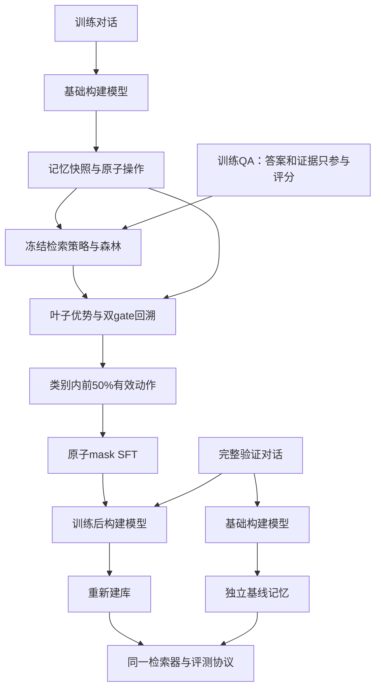

# 模型、方法与实验架构

## 根目录分层

| 目录 | 职责 |
|---|---|
| `models/` | HF/vLLM模型适配、Tokenizer与五角色配置 |
| `memory/` | 四类记忆、工具schema、Chroma、版本与来源 |
| `methods/retrieval/` | 检索树、奖励、intra/inter优势和MoT-GRPO目标 |
| `methods/construction/` | 形成/演化采样、回溯归因、类别内筛选 |
| `training/` | HF/verl检索更新、原子mask SFT与检查点 |
| `evaluation/` | F1、BLEU-1、judge与HF导出验证 |
| `experiments/` | 阶段编排、进度、恢复、预算和对照 |

`memory/formation_tools.py`保留公开形成工具，`memory/formation.py`增加paper-v2 CrtRaw。`memory/update.py`和`memory/retrieval.py`承载仍被训练使用的公开协议；它们不是一套独立旧入口。移除了只用于类型标注的旧HTTP客户端依赖。

## 模型角色

| 角色 | 权重/作用 |
|---|---|
| base | 原始个人Qwen3-4B，冻结参考 |
| construction | 从base初始化；形成与演化共享SFT权重 |
| retrieval | 已完成200步的检索HF模型，构建实验中冻结 |
| embedding | 个人BGE-M3，冻结 |
| judge | 原始Qwen3-4B，宽松LoCoMo协议独立报告 |

`models/`仅放Python适配代码。基础权重在个人远程`models/`，训练权重及数据库在项目`artifacts/`，均不随本次源码提升移动。

## 入口与历史

统一入口为`python cli.py`或`python -m cli`。根目录六个包直接导入，如`from training.sft import train_sft`。已删除`memt/`外层及`memt_training/`兼容别名，所有当前脚本与测试已迁移。

新实验继续保存配置、源码SHA、输入身份、阶段receipt与预算。旧实验manifest不改写；其旧模块路径应对照`artifacts/code-snapshots/`中的冻结源码。新代码不会绕过旧run的源码身份检查。
