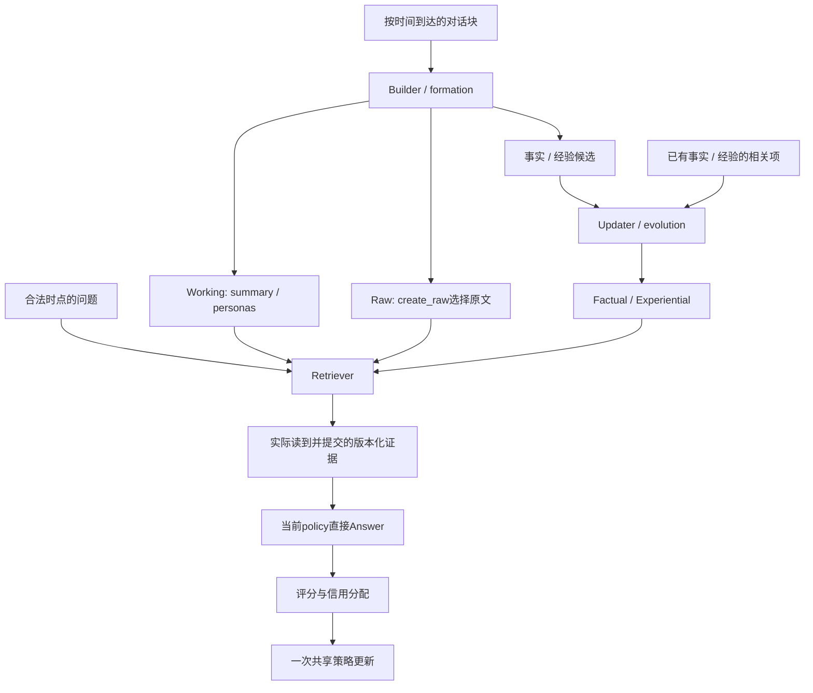

# Mem-T 四类记忆上的共享联合 RL：实验架构与完整流程 v1.0

更新日期：2026-11-04。本文保留已确认的研究设计，属于设计记录；当前实现、运行命令和验证范围以项目 README.md 与 IMPLEMENTATION.md 为准。项目已实现本地代码及 CPU 流程验证，尚未运行正式四卡训练。奖励系数、采样规模和训练日程是小规模验证的候选起点，不是已验证结论。

## 1. 当前决定与研究问题

用户已经明确选择：

1. 保留Mem-T的Working、Factual、Experiential、Raw四类持久记忆；本轮不新增持久语义树，也不加入未定义的Triggers。
2. Builder对应formation，Updater对应evolution；按对话块进行形成与融合，不再按“初始历史/后续历史”划分两个角色。
3. Builder、Updater、Retriever使用共享参数策略，通过角色Prompt区分。
4. Answer由检索 policy 通过 `finish(answer)` 直接生成；不使用冻结副本。
5. 主评测允许读取检索记忆关联的原文，所有对照统一预算；Memory-only作为诊断。
6. 使用已有paper-v2：Builder通过create_raw选择原文，Raw不自动全量归档。
7. 资源为4张A100 40GB；时间、磁盘预算可调整，训练规模尽量接近Mem-T。
8. B/U采用Global＋Local反馈；R采用固定记忆库上的MoT反馈，三者损失共同更新共享参数。R额外加入Global优势只作为消融。

从原研究设想保留：直接从基础模型做RL，不额外进行Agent预训练或SFT。Mem-T原有构建SFT流程可作为对照；这是主方法与对照的区别。

当前核心问题：**固定记忆表示与工具能力后，形成、更新、检索能否通过一个共享策略的联合反馈相互改善，优于分离训练和只优化检索？** 第一版不再声称学习了持久树的父子结构。

原工作区的 Tree Memory 讨论稿属于历史方案，其中语义树动作、树结构指标和调用量算例不作为当前执行配置。

## 2. 继承内容与实际代码依据

| 来源 | 采用内容 | 边界 |
|---|---|---|
| Mem-T及本地复现 | 四类存储、形成/演化工具、检索操作树、来源版本、检索训练后端 | 当前构建训练是回溯筛选后SFT，不能称为已有三角色共享on-policy RL |
| Memory-R2 | 完整生命周期反馈、相同中间状态的局部重采样、共享Prompt角色、长度归一化 | 扩展到三角色、四类存储及检索操作树的组合是本方案设计 |
| 当前新增 | 共享优化器、B/U局部候选、直接 finish(answer)、角色/分支权重、联合运行编排 | 不宣称恢复了作者未公开的训练流水线 |

版本固定为[Mem-T v2](https://arxiv.org/html/2601.23014v2)与[Memory-R2 v1](https://arxiv.org/html/2605.21768v1)。本地`UPSTREAM.lock.json`记录的是研究重实现的来源；正式运行仍需保存活动源码哈希，不能只报上游commit。

## 3. 三个角色与真实读写路径

| 角色 | 输入 | 动作/输出 | 数据库效果 |
|---|---|---|---|
| B | 当前块、前一工作摘要、人物信息 | create_fact、create_experience、update_summary、update_persona、create_raw | Working和Raw直接写入；事实/经验成为U候选 |
| U | B给出的一个候选、同类型top-k相关项、当前时间 | add_item、update_item、delete_item、ignore_item | 修改Factual/Experiential |
| R | 问题、合法评估时间、逐步工具观察 | search_summary/facts/experiences/personas/turns；终止并提交证据 | 数据库只读 |

这些路径来自`methods/construction/rollout.py::construct_episode`、`memory/formation.py`、`memory/update.py`和`memory/retrieval.py`。四类记忆在代码中对应五个collection，因为Working分成summary与personas。

按块进入B→U流程，但现有实现不是固定“两次LLM调用”：B的一次completion可包含多个工具调用；每个事实/经验候选触发一次U模型调用。若仅产生摘要或Raw，则该块U阶段没有可融合候选。建议保留这条真实调用链，记录实际次数；若要求无候选时也强制调用U，需另外改协议，目前不默认引入。

原有一个completion包含多个操作的能力可保留。RL训练单元先取整次模型调用，不能把同一completion拆成多个全长训练样本而重复计权。原子操作span和来源血缘继续保存，用于诊断和Mem-T SFT对照。

共同执行协议建议先校验整次completion的schema与允许参数，再执行；策略协议失败时不允许靠其中的合法片段获取完整候选奖励。执行时失败的回滚单位和快照需在P2固定并对全部主组一致，不能一边丢弃非法训练样本、一边保留它带来的有利写入而不记录。

## 4. 模型身份与梯度边界

策略πθ由同一基础模型初始化；B/U/R不分别加载既有训练checkpoint。现有`configs/models/qwen3-4b.yaml`指向个人`models/Qwen3-4B`，`models/hf.py`关闭thinking。主实验建议沿用该精确模型，运行前核实权重来源、revision、config和Tokenizer哈希；不把名称不完整的“Qwen3-4B-Instruct”默认为另一个2507版本。

每轮采样时θ_old固定；π_ref为冻结基础模型，用于KL；Answer仍由同一当前共享策略完成`finish(answer)`；B/U候选的检索评估器使用本轮θ_old的greedy Retriever，整轮不变。θ_old只是采样/评分快照，不是额外训练的Agent。

只有当前策略在实际生成token上的logprob接梯度。Prompt、工具观察、数据库、评分、优势、旧/参考概率、greedy评估续接生成均停止梯度。

所有采样completion保留真实prompt_ids/response_ids、采样参数与旧策略版本；在任何更新前计算和保存old_logprob。温度、截断采样、stop/EOS设置需与重算概率一致，并审计vLLM与训练前向的偏差。

## 5. 数据划分与时间协议

主数据使用LoCoMo，沿用本地`memory/data.py::prepare_locomo`的对话级1/1/8划分与category 1–4。保存原始输入哈希、sample_id、QA清单和证据审计；同一对话的窗口、改写或多次rollout都不跨集合。

Memory-R2的2/1/7划分与本实验不同，其方法移植需在相同1/1/8协议下重跑。不同划分、问答器、checkpoint来源的论文数字不能拼接成同条件主表。

LoCoMo标准QA主结果仍在完整历史终态评测。辅助在线更新集单列，包含新事实、重复、状态变化、纠错、历史追问及缺失信息；其时间和答案必须核验，不能仅凭最后一个evidence所在会话就断言原始问题适合该前缀。

训练B/U只读截至当前时刻的对话和状态，不输入QA、gold answer或gold evidence。R只接收问题、合法问题时间和工具观察，不提供真实题型标签。未来QA可以在离线终态评分中监督更早的记忆决策，未来对话不能提前传入策略或前缀评估器。

训练前缀没有合法监督题时：使用预先核验的训练probe，或跳过该Local并记录；不借用验证/测试题，不把尚不可回答的未来题当作负样本。短程课程的截断终点与原生终态QA不是同一个评测时点。

LongMemEval-S作为OOD评测，主指标按官方judge协议报告Accuracy，F1辅助；当前适配将证据会话扩成turn集合，因此默认只报告会话级证据召回，不冒称精确turn级Evidence F1。单个LoCoMo训练对话的局限要如实报告，重复采样不等于更多用户数据。

## 6. Raw、来源与直接Answer接口

paper-v2的create_raw只能选择当前块的真实turn_ids，工具复制原文。用于审计/评分的完整对话不自动成为可检索Raw库；search_turns只能查询策略实际归档的Raw条目。

事实、摘要等条目仍允许带来源原文，与现有Mem-T保持一致。但必须记录其真实物理存储和显示成本：只削减Raw collection而在每个事实或summary中复制全量原文，不算获得总存储压缩。

检索轨迹分别记录：`retrieved_memory_refs`、`displayed_source_ids`、`submitted_memory_refs`、`submitted_source_ids`。元数据继承的全部source_turn_ids不等于实际显示的原文；版本档案存在也不代表普通查询可访问全部旧版本。

主接口沿用 Mem-T 的 `finish(answer)`。执行器只从本条轨迹真实读到的版本构造证据诊断，答案文本由当前检索 policy 直接产生；不调用冻结 Answer。

这项接口变化对全部主实验对照一致。原版finish(answer)、原版fallback和已发布checkpoint可单列原协议结果；不能与新共同接口结果混为严格同条件。

主实验Source-backed与诊断Memory-only分别重新运行R：后者隐藏所有来源原文，并禁用search_turns，否则并非只读记忆。此时不计算要求原文显示的Evidence F1，QA与行为成本单独报告。另做同一R轨迹仅移除Answer原文的受控诊断时，须标明R此前见过原文，不能称为完整Memory-only。

主协议保留 Mem-T 风格 visible-evidence fallback：未合法终止或超预算时，使用当前 policy 对已展示证据补答；fallback 单独统计，不能冒充正常 finish。

## 7. 一轮联合训练

1. 采样训练对话、可见前缀和同一份scorer题单；冻结θ_old。
2. **Global**：采K=4条完整B→U记忆生命周期；合法QA时点各采一条R检索链。保存每会话/块的状态、生成与证据包，不在采样中更新参数。
3. **B Local**：从Global选一个块前anchor，固定完整数据库、工作状态、当前块和输入视图；采K_B=4个B completion。候选的直接Working/Raw写入及事实/经验提取各自执行；随后用固定的greedy U处理其候选，评价块结束状态。只训练候选B的真实生成，不训练该评估续接中的U。
4. **U Local**：固定同一个B输出、B的Working/Raw副作用、块内事实/经验队列和U开始前状态；采K_U=4条融合序列，按现有逐候选调用执行到块结束。候选从独立副本开始，训练该序列真实U调用。
5. **R Local**：固定一份合法记忆快照和问题，使用现有MoT森林采样；主探针沿用G=3、depth=4、pivots=3、M=1。推理步数另按明确配置记录，扩到6步需同条件对照。
6. 使用当前 policy 的 finish(answer) 计算 Global 与 Local 评分；fallback 调用不放入正常检索训练行。
7. 分别计算各group优势和各角色损失，执行一次共享optimizer update；保存运行身份和恢复状态。

连通性探针先各一个B/U anchor、一个R Local问题。正式阶段R Local目标是每次共享更新累积32个固定(记忆快照,q)问题组，以接近Mem-T每步query batch32；按四卡microbatch串行/分批处理，不要求同时驻留32个森林。其库可以不同，但每个问题自己的候选共用同一库，绝不跨库混组。

优先32个不同qa_id；若同一QA分配到不同快照，要分别记录问题数与state-query pair数，不冒称32个独立问题。短前缀不足32道合法题时使用真实可用数并记录，不复制题目凑batch或借用未来证据；课程后期达到完整历史再扩大。原检索batch32只作为R分支量级参照，不代表32个完整记忆生命周期。

Local克隆必须覆盖collection内容、索引可见性、Journal版本、summary/personas、来源集合和游标；只复制数据库引用或只copy一个Python外壳不算隔离。固定输入块与候选集合时，查询top-k与排序也需一致。

## 8. 奖励定义：先保留可核对的少量项

本节均为新方案候选定义。令f(q)为当前共享检索策略通过`finish(answer)`直接生成的token F1；e(q)为已显示并提交原文的证据召回。缺失/不完整证据单独标记，不把空标注当作0分；有多个可接受证据组时对各组取最优匹配，不强制检索所有替代证据。

e(q)不可用的题使用u(q)=f(q)−βc_R(q)，并排除于证据指标分母；QA指标仍保留该题。跨候选使用相同题单与可用性mask，避免把标注缺失差异当成候选性能差异。

令c_R为该题检索生成与工具输出token相对统一预算的比例；Answer生成单列计费。定义单题效用：

$$
u(q)=f(q)+\alpha e(q)-\beta c_R(q).
$$

建议初始α=0.5、β=0.05，只作为小规模起点。m是四类可检索内容的总token与截至当前时点输入token之比，正文中复制的来源也计入；另报告向量、原文重复存储、审计版本和总bytes。为使各奖励项有明确范围，候选存储惩罚用c_M=m/(1+m)，编辑惩罚用c_E=本段实际写入/改写token÷(该token数+当前输入块token数)，均在[0,1]。这种有界软惩罚不等于有限存储保证，仍需报告未压缩的m、总bytes和固定存储预算下的质量曲线。

Global：完整生命周期质量由合法题效用均值减η·时间平均c_M评价。B/U在时刻t使用此后合法评估题的reward-to-go，U可再扣本段编辑成本；R只对本题负责。终态-only数据会让多个早期记忆步骤共享粗全局信号，这是数据限制，不能伪称有精确逐步因果奖励。

具体地，Q_after(t)是在该条完整轨迹中评估时点不早于t的合法题单，S_after(t)是t及之后已生成的会话快照集合。候选全局回报为：

$$
G_{B,t,i}=\operatorname{mean}_{q\in Q_{after}(t)}u_i(q)-\eta\operatorname{mean}_{s\in S_{after}(t)}c_M(M_s^i),\qquad
G_{U,t,i}=G_{B,t,i}-\xi c_E(i,t).
$$

t按会话/块语义位置对齐，i是同一episode的Global候选。U的c_E只计对应块的实际编辑，B不为未发生的U调用伪造编辑量；各自生成均归入其真实时间块。没有合法QA的组不把缺失QA填成0，记录并跳过该QA优势。Global R仅提供上述u_i(q)，其生成不进入主方法的R策略损失。

B Local：固定greedy U/R与当前策略的`finish(answer)`，评价候选块结束状态的合法题效用减ηc_M。U Local：同一组历史/当前题下，比较J(M_after)−J(M_before)−ξc_E；J对两类题的u各求均值再等权汇总，扣除ηc_M，空缺类别显式记录。before基线同anchor只计算一次。η=0.05、ξ=0.01作为候选起点，绝非论文已验证的系数。

同一组内减去公共before常数会被中心化消掉；它有监控意义，不会凭空改善组内信用分配。历史保持依靠明确的历史题及其权重，不能只靠版本ID数量。

R Local沿用MoT的子节点均值传播与intra/inter归一化思路，叶子由当前共享策略的`finish(answer)`评分；根不参与训练统计。增加成本项后已是适配版本，不称为原公式不变。每个节点的证据与成本只由实际前缀观察计算，终态答案不能提前放进中间Prompt。

明确实现为：合法终止叶v的P(v)等于当前共享策略对该证据包生成答案的F1；未完成或非法叶的P(v)=0；内部节点P(v)=直接子节点P的均值。合法节点的R(v)=P(v)+αE(v)−βC(v)，非法节点另用下述协议惩罚。E(v)在中间节点取实际显示原文的证据召回，在STOP节点取实际提交原文的召回；C(v)取该前缀累计生成与工具输出的归一化成本。这里传播的是P，不把节点累计成本反复当作最终QA表现传播。

随后A(v)=z_tree(R(v))+z_forest(R(v))：前项只对同一操作树的非根唯一节点标准化，后项对同一固定(记忆快照,q)森林的全部非根唯一节点标准化；不能对不同问题混算forest均值。合成根无生成token、不参与损失。分组和每个P/E/C/R分量均需落盘，以便区别答案质量、证据和路径成本。

无效completion不能因合法候选受成本扣分而相对获益。候选实现将策略协议失败设为低于合法回报下界的值；上述范围内可用−3：当α≤1、β/η≤0.05、ξ≤0.01时，U差分的合法下界不低于−2.11。若以后改变范围，必须重新验证，不能继续盲用固定惩罚。数据库/资源故障直接中止，不伪装成策略负样本。深度耗尽的未完成轨迹和内部节点证据奖励规则需单独测试终止率，不能悄悄补未采样的finish。

## 9. 优势分组与共享损失

Global在同一episode、同一角色、同一语义时间块的K条路径间归一化；Local在相同anchor的候选组内归一化。使用总体标准差，零方差组优势为0并统计比例。不同角色、不同时间、不同anchor的原始奖励不能混组。

对一个可比组g，A_gi=(R_gi−mean(R_g))/(sqrt(mean((R_g−mean(R_g))²))+1e-6)，mean仅在该组候选上计算，A停止梯度。每条生成记录必须携带能够复核这一分组的键，不能仅保存最终advantage数值。

MoT的intra/inter属于固定树库和同一问题下的操作节点统计；它不等于Global/Local的分支划分。重复采样pivot时，共享生成前缀只计一次，不能为每条叶子路径重复监督同一生成。

用户已确认主方法：B/U各有Global+Local损失；R使用固定库上的MoT Local损失。Global R链仍生成并为B/U提供下游评分，但不将其跨不同记忆库归一化后的优势再训练R，以减少存储质量对检索信用的污染。“R也加Global损失”作为明确消融，不默认为论文原法。

候选角色权重：

$$
L=\tfrac13[\tfrac12 L_B^G+\tfrac12 L_B^L]
 +\tfrac13[\tfrac12 L_U^G+\tfrac12 L_U^L]
 +\tfrac13 L_R^{MoT}.
$$

每候选先平均真实模型调用，再平均候选、anchor与episode；MoT按唯一节点/树/问题平均。无候选的U阶段不伪造生成样本，记录该角色缺项，不暗中重分配其他权重。

一次调用u的生成token数为L_u，整步概率比和裁剪损失候选为：

$$
\rho_u=\exp\left(\frac1{L_u}\sum_l[\log\pi_\theta(y_{u,l}|h_{u,l})-\log\pi_{old}(y_{u,l}|h_{u,l})]\right),
$$

$$
\ell_u=-\min[\rho_u A_u,\operatorname{clip}(\rho_u,1-\epsilon,1+\epsilon)A_u]+\beta_{KL}\bar k_u.
$$

A_u、旧概率与参考概率detach；bar k是仅在生成token上平均的参考KL surrogate。先用普通PPO clipping，不称为Memory-R2完整dual clipping；熵奖励先设0。KL在各调用内已计入，不再重复加总。

现有`mot_loss`是逐token裁剪后平均，与上述先聚合ratio再裁剪不同。主方法建议step-ratio，保留token-clipping受控消融；这是本方案的优化选择，不把不同公式当成已经等价。

## 10. 训练规模：与Mem-T对齐什么

[Mem-T v2实验设置与附录A.2](https://arxiv.org/html/2601.23014v2)给出的量级是检索RL 200步、global query batch32，构建侧约10k操作和200步最大似然更新。不能将新方案的200次联合更新直接等同于原方法两个训练阶段。

建议首先固定**主方法200次共享更新**作为步数参照，记录B/U/R各自生成调用与原子操作数量；不为凑10k复制操作，也不把一个含多动作的completion同时算成多次独立采样。

连续联合训练课程的初始候选日程：前40轮最多4会话、接着60轮最多8会话、最后100轮逐步覆盖16/32及完整合法对话。是同一个共享策略的RL课程，不提前训练独立R或做SFT。该日程尚属候选；若前缀监督不足，先修正训练probe/合法题选择，不能硬套数字。最终评测完整历史。

先在新流程上完成10轮profile，分别统计：策略生成、greedy评估续接生成、Prompt/输出token、概率重算/反向时间、峰值显存/主机内存、保存时间与磁盘增量。R Local逐级试1/4/8/16/32问题组；再锁定每轮Global题数与B/U Local anchor数，使总计算量与重跑的Mem-T训练范式接近。R Local理论最多200×32=6400次问题组访问只作对照量级，正式报告实际累计数，不能把短前缀不足时的缺项写成已完成。

公平结果同时给：①200更新的步数参照；②相同实际GPU小时或明确的生成/评估预算下的质量曲线。共享方法达到预算上限时使用已完成的验证选定checkpoint；不偷减其他方法采样量。仅训练token等量不能代表端到端生成与评估总成本等量。

## 11. 四卡候选配置与运行安排

| 项目 | 第一轮候选配置 | 验证要求 |
|---|---|---|
| 训练方式 | 全参数BF16、FSDP四卡、梯度检查点 | 实测采样、优化、保存/导出各阶段峰值 |
| 上下文 | 总6144，生成≤512起步 | 参考原构建训练长度；检索超预算率高时再对照8192 |
| 对话块 | 先沿用4 turns/block | 不静默改成新的token分块协议；超预算明确记录 |
| Global / B Local / U Local候选 | 正式候选4，连通性smoke可用2 | 非零优势率、实际可用anchor数、成本 |
| U相关项 / 检索top-k | 3 / 5起步 | 与现有配置一致；额外原文计入token |
| R MoT | G=3、depth=4、pivots=3、M=1 | M是本地复现选择，不称为作者唯一配置 |
| R问题组 | smoke 1，逐级扩至正式目标32 | 不同问题/快照各自分组，期间θ_old锁定 |
| R调用上限 | 训练4步；主评测6步，均含终止调用 | 记录训练/测试差异；另附4步同预算诊断；无隐式fallback |
| LR / clip / KL | LR 1e-6起步并比较5e-6；0.2；0.001 | 验证集选择；正式warmup需独立固定 |
| 主机内存 | 128GiB作为申请起点 | 现有历史运行保存期有CPU OOM记录；不是新流程可运行保证 |
| 磁盘 | 根据完整检查点峰值重新设预算 | 用户允许调整，旧100GB不自动沿用，也不删除历史run腾空间 |

Answer不再使用独立冻结模型。候选分相顺序：θ_old完成所有策略采样（含`finish(answer)`）→更新前保存old/ref logprob→一次共享更新。采样不依赖额外的二次Answer调用；fallback也使用当前共享策略，仅允许看到已显示证据。所有推理引擎输出和缓存都按模型版本、题目、时间、证据包哈希区分。

真实4B短程2–5步检查须实际使用正学习率、非退化优势并验证参数变化。已有微型恢复测试不替代新流程真实4B完整恢复；只有optimizer.step计数也不证明参数变化。

## 12. 可复用与新增代码

建议使用独立源码分支/副本保持Mem-T根目录导入布局，新增最少的joint模块；本轮不创建或修改生产源码，不覆盖旧实验。

| 位置 | 复用 | 必须补齐 |
|---|---|---|
| memory/formation.py、formation_tools.py、update.py | 四类动作、Prompt、工具实现 | 时间/来源/失败协议检查；共同适配对照 |
| memory/journal.py | 版本与来源、快照 | Local独立副本、游标/工作态、实际显示来源 |
| methods/construction/rollout.py | 分块与调用链、原子span记录 | 可在块边界暂停/恢复、分角色token记录、on-policy Global/Local采样 |
| methods/construction/credit.py、training/sft.py | Mem-T回溯SFT对照与诊断 | 主方法不再走筛选→SFT更新 |
| methods/retrieval/tree.py | 森林采样、子节点传播、intra/inter | `finish(answer)`终止叶评分、证据包、实际来源显示、预算 |
| methods/retrieval/loss.py、training/verl_actor.py | 概率、KL、分布式前向 | step-ratio、role/branch/group权重、共享优化 |
| training/verl_backend.py、models/roles.py | FSDP/vLLM基础与模型适配 | `finish(answer)`接口、共享策略身份；旧五角色路径配置不是共享权重证明 |
| experiments/workflow.py、progress/checkpoints | manifests、阶段、预算、恢复 | 动态完整生命周期编排；固定MemoryRun只适合静态检索/对照 |

建议新增`methods/joint/rollout.py`、`credit.py`、`loss.py`与一个联合runner；先复用工具和后端，不复制另一套数据库、模型加载器或复杂Agent框架。新增CLI及Slurm命令应在实现后从真实help生成，本文不伪造已存在的联合训练命令。

## 13. 实验顺序与阶段验收

| 阶段 | 工作 | 验收 |
|---|---|---|
| P0 协议锁定 | 模型/数据/Prompt/工具/预算/题单身份；继承已有基线资源记录 | 运行manifest完整；gold仅scorer可见 |
| P1 无训练闭环 | paper-v2建库、R取证、当前策略`finish(answer)`；小型变化/历史追问实例 | 四类读写正确；同条件基线；原文显示不虚报 |
| P2 采样环境 | Global与B/U/R Local，克隆、当前策略评分、版本与游标 | 候选互不污染；前缀不含未来内容；旧状态可复现 |
| P3 数值验收 | 小模型验证ratio、mask、归一化、权重、去重和恢复 | 手算/梯度对应；环境与固定模型无梯度；完整恢复一致 |
| P4 真实4B探针 | 2–5次共享更新、导出重载、完整保存/恢复 | 非退化信号、参数变化、资源峰值、真实4B恢复证据 |
| P5 Profile | 新流程10轮及两组20轮单种子对照 | 质量/成本可解释；据实锁定规模和日程 |
| P6 正式主实验 | 主方法及关键对照200更新参照、至少3种子 | 同模型同数据同Answer；重新建库；完整终态/OOD评测 |
| P7 消融与报告 | 信用分支、共享与成本曲线 | 每个结论有对应受控对照，不用短程增益代替最终证据 |

P4不要求几步就提分；如果某角色长期无候选或零方差，先定位格式、检索评估器与probe覆盖，不通过复制数据、注入测试答案或偷偷加SFT解决。训练可由短程到长程逐步运行，用户目前授权的是实验设计，尚未提交GPU作业。

## 14. 主对照矩阵与公平性

全部主组使用同一四类存储、paper-v2、基础模型、证据协议、当前策略`finish(answer)`和评测题单。

| 组 | 训练 | 回答的问题 |
|---|---|---|
| M0 | 全部冻结、无训练Prompt基线 | 共同接口起点 |
| M1 | 只训练R：MoT；B/U固定基础模型 | 纯检索训练能到哪里 |
| M2 | 只训练B/U：Global+Local；R固定基础模型 | 写入侧RL收益 |
| M3 | 三角色共享，但B/U仅Global，R仍MoT | B/U Local是否有效；本组不称为所有角色Global-only |
| M4 | 三角色共享：B/U Global+Local，R MoT | 推荐主方法 |
| M5 | 与M4相同交互流程，B/U/R参数分离 | 参数共享本身的影响；独立策略参与同一生命周期，仍是联合目标 |
| M6 | Mem-T两阶段训练范式：R训练，再回溯筛选构建SFT | 相对既有训练方式的整体效果；训练范式、参数结构一起变化，不能单独归因共享 |

M5用相同Global/Local状态分布和奖励分别更新θ_B、θ_U、θ_R，其余角色采样期间固定；它隔离共享参数，不能命名成“不联合优化”。若研究真正Independent RL，再加M7：各角色仅各自Local，在固定其他角色下训练，最后拼接；该组同时改变目标与状态适应，结论要分开。

必要消融优先：M3→+B Local→+U Local→Full；R MoT改为等实际采样预算的独立链；step-ratio与token-clipping；R是否额外使用Global优势；QA-only与QA+Evidence+Cost。共享与独立参数都需报告总训练参数、推理驻留、存储和计算，不要求它们有相同物理模型数。

M6若使用历史checkpoint，要核验训练数据暴露与协议；否则重训共同接口版本。另列原协议Mem-T结果用于背景参考，不将修改过Answer或工具接口后的结果标成原论文复现数字。

## 15. 评测、归因与产物

主指标：LoCoMo F1/BLEU-1与固定judge；LongMemEval官方Accuracy。辅助：真实显示/提交证据召回、Historical QA、Current QA、Raw选择率、四类存储量、来源重复量、修改率、检索轮数、STOP率、无效动作率、每角色零方差组率与梯度范数。

成本：分别记录策略生成、greedy R/U续接、当前策略`finish(answer)`和judge调用；Prompt/输出token、GPU小时、p50/p95延迟、四卡与主机内存、完整checkpoint/导出峰值和总bytes。不能用模型训练token等量替代整体计算等量。

失败链：`信息在可检索内容中 → 版本/时间正确 → 被检索 → 真正显示 → 提交给Answer → 答对`。使用gold证据直答、正常检索、Memory-only诊断区分写入、访问、原文补救与回答器错误。M-Fail若仅用来源ID覆盖定义，应标为定位指标而非语义事实保留证明。

每个训练后checkpoint均以自己的B/U从头重建验证/测试库；禁止沿用训练前库后声称端到端提升。验证选checkpoint，测试不参与调参；原始终态QA与合成在线probe分表。

至少3种子给均值和标准差；LoCoMo按对话聚类做paired bootstrap，说明少量测试对话的区间限制。历史训练记录只作工程参考，不当作当前远程运行状态或新方法结果。

产物位于个人`/public/home/wwxia/yuang.li/workspace/AgentMemory/artifacts/memt-joint/<run-id>/`，分data-manifest、snapshots、rollouts、rewards、metrics、checkpoints、evaluation、report。基础下载权重仍在个人`models/`；数据、权重和大结果不提交Git。

每次实验保存完整实际命令、代码/配置/输入/模型身份、Conda环境、策略版本、seed、时间、路径和各阶段receipt。恢复核验optimizer/scheduler、各rank RNG、游标、快照与题目顺序；只在完整产物后发布COMPLETE，失败或超时不等于可恢复成功。

## 16. 已收敛架构与后续实施边界

四类记忆、formation/evolution分工、paper-v2、当前策略`finish(answer)`、原文访问、规模原则和B/U Global+Local、R固定库MoT均已由用户确认。主架构中只有一个可训练参数集合和一个共享优化器；固定评估快照不构成独立训练模型。

实施时按P0–P7推进。P0固定真实模型与数据身份；P1–P4实现并验收共同接口、状态隔离、数值损失与四卡恢复；P5用实测选择奖励系数、题数、学习率和课程；之后锁定配置再做正式对照。profile后改变超参数需记录在新配置和run中，不静默更换已确认的表示或角色分工。

本次交付完成的是架构、源码映射、实验矩阵、规模对齐和分阶段流程。源码实现、Slurm提交、真实4B资源验收、正式训练与结果分析均未执行；它们是本文规划的后续工作，不能用本稿或历史Mem-T记录充当执行证据。
